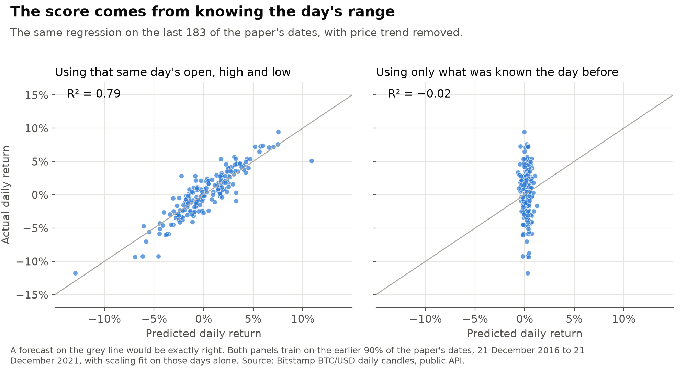
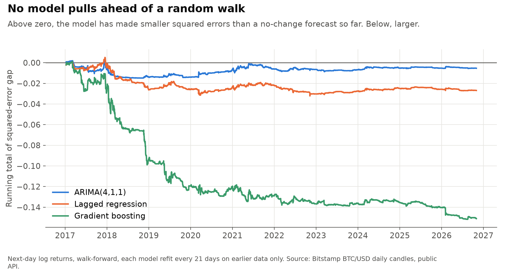
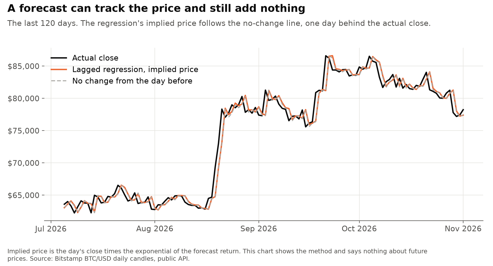
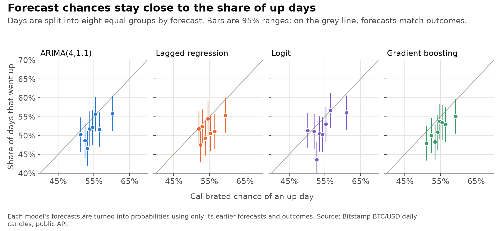

# btc_forecast_check

[](https://github.com/atamalfuzi/btc_forecast_check/actions/workflows/tests.yml)

A rebuild of an unpublished 2022 study of mine, "Bitcoin price forecasting using different methods". It concluded that a linear regression forecast Bitcoin's closing price with a score of 0.9994. That score came from using the same day's high and low to predict the same day's close. Using only earlier information, on one common scale, across 3,582 days from January 2017 to November 2026, none of the models beats a forecast of no change. Python, with statsmodels and scikit-learn.

This is a lesson in method. It isn't a trading system or investment advice, and nothing here says what Bitcoin's price will do.

> **Personal project.** This is my own analysis of publicly available data. It is not associated with my work for any current or past employer and does not represent their views.

| Question | Methods | Answer |
|---|---|---|
| [Where did 0.9994 come from?](#1-where-did-09994-come-from) | Same regression, with one problem fixed at a time | Look-ahead. R² on daily returns falls from 0.80 to −0.01 once the day's own prices are removed. |
| [Could the paper's models be ranked by MSE?](#2-could-the-paper-rank-its-models-by-mse) | One forecast measured on each scale | No. The same forecast has an MSE from 0.0006 to 2.8 million depending on the units. |
| [Does anything beat a random walk?](#3-does-anything-beat-a-random-walk) | Walk-forward, Diebold-Mariano, Clark-West | No. ARIMA and the regression are indistinguishable from it, and gradient boosting is worse. |
| [Can direction be forecast?](#4-can-direction-be-forecast) | Logit, walk-forward calibration, Brier scores | Barely. Accuracy of about 51.7% against 51.6% for always saying up. |

## What the paper reported and what changed

| | 2022 paper | This rebuild |
|---|---|---|
| Sample | 2016-12-21 to 2021-12-21 | Trained from 2015-01-10, scored from 2017-01-10 to 2026-11-01 |
| Target | Same-day close in levels for the regression, log-differenced price for ARIMA, up or down for the logit | Next-day log return and the price it implies, for every model |
| Inputs | Same-day open, high, low and volume | Only what is known at the previous close |
| Validation | Random 10% of days and unshuffled k-fold, so training includes later days | Walk-forward, with each refit using only earlier days |
| Scaling | Min-max on the dataset | Fit on the training days at each refit |
| Benchmark | None | Random walk, and the share of up days so far |
| Comparison | MSE on three different scales | Same scale, with Diebold-Mariano tests |
| Conclusion | The linear regression performs best | No model beats the random walk |

## 1. Where did 0.9994 come from?

The fitted equation in the paper predicts each day's close from that day's open, high, low and volume. The high and low are only known once the day is over, and the close always sits between them. A forecast made that way can't be made in time to use.

I don't have the original estimation code, so I rebuilt the setup from the paper's description and its data file. Row 1 reproduces the reported score. The paper describes k-fold, but the test rows it prints (5, 14, 16, 24, 39) aren't consecutive and its test chart has 183 points, which fits a random 10% of days.

| Step | Inputs | Target | Validation | R², paper's file | R², Bitstamp |
|---:|---|---|---|---:|---:|
| 1 | Same day | Price, min-max scaled | Random 10%, mean of 200 draws | 0.9995 | 0.9994 |
| 2 | Same day | Price, min-max scaled | 10 unshuffled folds | 0.9947 | 0.9939 |
| 3 | Same day | Price | Last 10%, scaled on the past | 0.9947 | 0.9943 |
| 4 | Day before | Price | Last 10%, scaled on the past | 0.9705 | 0.9698 |
| 5 | No-change forecast | Price | Last 10% | 0.9713 | 0.9703 |
| 6 | Same day | Log return | Last 10%, scaled on the past | 0.7974 | 0.7914 |
| 7 | Day before | Log return | Last 10%, scaled on the past | −0.0148 | −0.0197 |
| 8 | No-change forecast | Log return | Last 10% | −0.0047 | −0.0046 |

Fixing the validation (row 3) barely moves the score, because the leak is in the inputs. Removing it (row 4) still leaves 0.97, which looks like a good result until row 5 shows that repeating yesterday's price scores the same. A price level is close to its value the day before, so R² on levels says little. Rows 6 to 8 ask the same question about returns, where the persistence is gone: 0.80 with the day's own prices, about zero without them.



The chart uses Bitstamp prices, so it matches the last column of the table.

## 2. Could the paper rank its models by MSE?

The paper's last table compares an MSE of 0.000029 for the regression, 0.001233 for ARIMA and 15.418 for the logit. Each is on a different scale.

| Forecast and scale | MSE, paper's file |
|---|---:|
| No-change forecast, price in dollars | 2,808,790 |
| No-change forecast, log return | 0.001216 |
| No-change forecast, price min-max scaled | 0.000630 |
| No-change forecast, price min-max scaled, all 1,827 days | 0.000187 |
| ARIMA(4,1,1) refit daily, log return | 0.001238 |
| Paper's ARIMA(4,1,1), log return, as reported | 0.001233 |

The first three rows are one forecast on the paper's 183 test days. On its own scale, the paper's ARIMA is slightly worse than that no-change forecast, which the paper had no benchmark to show. The regression's 0.000029 was measured on random days across the whole sample, so the fair comparison is the fourth row. It is about six times smaller than 0.000187 because the regression was given the day's high and low.

The logit's 15.418 is not an MSE. It equals the log loss of hard 0 or 1 predictions at the reported accuracy: −ln(10⁻¹⁵) × (1 − 0.5536) = 15.418. It says the logit was wrong on 44.6% of days, which can't be compared with a squared error on a price.

## 3. Does anything beat a random walk?

Each model forecasts the next day's log return from the previous close. All models are refit every 21 days on earlier days only, and the scaler is refit with them. The inputs are five lagged returns, the day's high-low range, volume against its 30-day average, and 30-day volatility and momentum. Model settings were fixed before scoring and not tuned.

| Model | Root MSE, log return | Out-of-sample R² vs random walk | Diebold-Mariano, squared error (p) | Absolute error (p) | Clark-West (p) | Implied price, mean error |
|---|---:|---:|---:|---:|---:|---:|
| Random walk | 0.0359 | 0 | | | | 2.37% |
| ARIMA(4,1,1) | 0.0359 | −0.12% | 0.35 (0.73) | 0.55 | 0.14 | 2.37% |
| Lagged regression | 0.0360 | −0.58% | 1.51 (0.13) | 0.49 | 0.22 | 2.38% |
| Gradient boosting | 0.0365 | −3.27% | 3.31 (0.001) | <0.001 | 0.05 | 2.45% |

3,582 days. A positive Diebold-Mariano statistic means larger errors than the random walk, and p-values are two-sided, using Newey-West variance and the Harvey-Leybourne-Newbold correction. The Clark-West test is one-sided: does the model contain anything a no-change forecast leaves out? It suits the two linear models, since a random walk is nested in them, and neither passes. Gradient boosting's 0.05 sits beside forecasts that are measurably worse, so at best it means there is a faint signal it can't turn into a better forecast. Across these three models and tests, I wouldn't read anything into one p-value of 0.05.



The R² on implied price levels is 0.9985 for the random walk and 0.9984 or 0.9985 for every model. That number, close to the paper's, is available to anyone who forecasts yesterday's price.



With this many days, the standard error on out-of-sample R² for the two linear models is about 0.36 points, so a true R² under about 0.7% couldn't be told from zero. These results don't show that returns are unforecastable. They show that these models, with these inputs, don't forecast them well enough to detect.

| Period | Days | ARIMA, R² (p) | Lagged regression, R² (p) | Gradient boosting, R² (p) |
|---|---:|---:|---:|---:|
| All scored days | 3,582 | −0.12% (0.73) | −0.58% (0.13) | −3.27% (0.001) |
| The paper's test days | 183 | −1.82% (0.07) | +0.01% (1.00) | −0.04% (0.99) |
| Through the end of the paper's file, 2022-11-01 | 2,121 | −0.16% (0.68) | −0.76% (0.10) | −3.58% (0.002) |
| After it | 1,461 | +0.09% (0.84) | +0.18% (0.74) | −1.98% (0.11) |

Extending the sample doesn't rescue anything. The small positive numbers are within noise. With a rolling 730-day window instead of all earlier days, every model does worse: −0.32%, −1.48% (p = 0.008) and −5.75% (p < 0.001).

## 4. Can direction be forecast?

The paper's logit results were its most reliable. It reported AUCs of 0.54 and 0.51 and said the model was right only around half the time, which matches what follows. Its 55.4% accuracy looks better than it is, since 54.5% of days in its sample went up.

Here every model's forecast is converted to a probability using a logit fit only on that model's earlier forecasts and outcomes, so the probabilities can be compared. The benchmark is the share of up days so far, which has said "up" on every scored day.

| Model | Accuracy | Calibrated accuracy | p vs benchmark | AUC | Brier score | p vs benchmark |
|---|---:|---:|---:|---:|---:|---:|
| Share of up days so far | 51.56% | 51.56% | | 0.515 | 0.2504 | |
| ARIMA(4,1,1) | 50.84% | 51.73% | 0.23 | 0.522 | 0.2503 | 0.76 |
| Lagged regression | 50.61% | 51.59% | 0.32 | 0.509 | 0.2505 | 0.29 |
| Logit | 51.76% | 51.70% | 0.59 | 0.523 | 0.2504 | 1.00 |
| Gradient boosting | 51.84% | 51.54% | 0.87 | 0.524 | 0.2501 | 0.15 |

Calibration moves the models toward saying "up" almost every day, which is why their calibrated accuracy lands on the benchmark's. If ARIMA and the regression go by the sign of their forecasts, they do worse than always saying up. The best AUCs, about 0.52, are a little over two standard errors above 0.5 (0.0097 each), before allowing for four models, and they don't carry through to accuracy or Brier scores. A coin flip's Brier score is 0.25.



## Other corrections to the paper

- **The return in the introduction.** It gives 14,752% for buying at launch. From the prices it quotes, $65 to $20,000 is 30,669%, and $65 to $68,789 is 105,729%. 14,752% would need a start near $135. And $65 is the all-time low it quotes, not a launch price.
- **The dates.** The paper gives 2016-12-21 to 2021-12-21 and 1,828 rows. Those dates hold 1,827 days. The data file in my folder runs 2014-09-17 to 2022-11-01, 2,968 rows. The reported scores reproduce on the stated dates, so it looks like a longer download that was cut, but the paper doesn't say so.
- **"H0 is accepted."** A Dickey-Fuller p-value above 0.05 means failing to reject a unit root, which isn't evidence for one.
- **The equation.** Equation 1 includes yesterday's close, but the fitted equation on page 17 leaves it out. Adding it wouldn't remove the same-day high and low.
- **The conclusion.** "Multiple Linear Regression performs better than ARIMA and Logit" doesn't hold. The comparison was across scales, and the regression wasn't a forecast.

A related paper, Uras et al. (2020), forecasts Bitcoin's closing price with lagged values as inputs, which a forecast needs and the 2022 paper's fitted equation didn't use.

## Limits

- One exchange. Daily closes are at midnight UTC on Bitstamp. Its closes differ from the paper's Yahoo file by 0.43% on average, and daily returns correlate at 0.989.
- A daily horizon and a small set of models and inputs. Nothing here covers intraday data, other assets or other predictors, and no costs are modelled because no trading is modelled.
- Parameters are held for 21 days between refits. Inputs still update daily.
- The first year of forecasts isn't scored, since calibration has to learn from it.

## Tests

`pytest` needs no downloads and runs on made-up prices. `tests/test_leak.py` is the important one: it corrupts every price after a chosen day and fails if any feature or forecast up to that day changes, for all columns and all models, with both window types. It also checks that the same test catches features built to leak (the next return, a centred average, whole-sample scaling), so a pass means something. `tests/test_evaluate.py` checks that the setup finds a real signal when one is planted and none in noise.

## Data

Daily BTC/USD candles from [Bitstamp's public API](https://www.bitstamp.net/api/), which needs no key. I found no licence that allows redistribution, so `data/` is not committed and `data.py` downloads it. The same goes for the Yahoo file used in the paper: the "paper's file" columns come from my own copy, which isn't included, and only summary numbers from it are in `output/`. [Coin Metrics' community data](https://github.com/coinmetrics/data) has a clear licence (CC BY-NC 4.0) but no open, high, low or volume, and when I checked it stopped in May 2026.

The sample starts 2015-01-10 because of Bitstamp's outage in early January 2015, which left flat candles with no volume on the 6th to 8th. Results are as of 2 November 2026, with data through 1 November. To extend them, move `LAST` in `data.py`.

The original paper isn't in this repository. Its numbers are quoted above.

## Run it

```bash
pip install -r requirements-dev.txt
pytest
python data.py
python leak.py
python forecast.py
python evaluate.py
python figures.py
```

`forecast.py` takes about 5 minutes. To reproduce the "paper's file" column, pass a Yahoo-format file: `python leak.py path/to/btc.csv`.

## References

- Clark, T. E. and West, K. D. (2007). Approximately normal tests for equal predictive accuracy in nested models. *Journal of Econometrics*, 138(1).
- Diebold, F. X. and Mariano, R. S. (1995). Comparing predictive accuracy. *Journal of Business & Economic Statistics*, 13(3).
- Harvey, D., Leybourne, S. and Newbold, P. (1997). Testing the equality of prediction mean squared errors. *International Journal of Forecasting*, 13(2).
- Uras, N., Marchesi, L., Marchesi, M. and Tonelli, R. (2020). Forecasting Bitcoin closing price series using linear regression and neural networks models. *PeerJ Computer Science*, 6, e279.

## License

MIT for the code. The data belongs to its providers and is not included.
